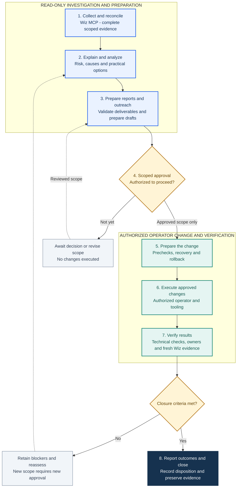

<div align="center">

# Cloud Security Remediations

### From Wiz findings to informed action.

**Evidence-led investigation. Clear reporting. Approval-controlled remediation.**

**Wiz MCP** &nbsp; / &nbsp; **AWS + Azure** &nbsp; / &nbsp; **Assistant-led workflow**

[Workflow](#eight-stage-remediation-workflow) &nbsp; · &nbsp;
[Setup](#setup) &nbsp; · &nbsp;
[Example requests](#start-an-investigation) &nbsp; · &nbsp;
[Privacy](#safety-and-privacy) &nbsp; · &nbsp;
[Guides](#guides)

</div>

---

Describe the finding or reporting scope in your approved assistant environment.
Use authorized Wiz MCP tools to collect evidence, understand the risk and prepare
deliverables for review, without losing sight of who approves the next step.

| **01 / Understand** | **02 / Communicate** | **03 / Act with approval** |
| :--- | :--- | :--- |
| Explain findings using actual resource, permission and exposure evidence. | Turn the investigation into readable reports and stakeholder drafts. | Plan scoped changes, verify outcomes and retain the evidence. |

> [!IMPORTANT]
> **Connected through your assistant, not a hosted service.**
> Wiz MCP operates in your configured assistant
> environment, not inside this repository's Python CLI. This repository provides
> supporting local tooling and documented review practices; cloning or installing
> it does not create a Wiz connection or an unattended remediation service.

## What you get

| Deliverable | Purpose |
| :--- | :--- |
| **Risk explanation** | What Wiz found, why it matters and what the evidence supports |
| **Scoped assessment** | Affected resources, access paths, safeguards and evidence gaps |
| **Practical remediation plan** | Environment-aware options, prerequisites and approval requirements |
| **Excel report and stakeholder drafts** | Reviewed findings, recommendations and a clear decision request |
| **Progress and verification history** | Observation cutoffs, decisions, blockers and retained evidence |

Deliverables depend on the available evidence, local tools and requested scope.
There is no universal report generator for every finding type.

## Eight-stage remediation workflow

**Automate preparation. Keep decisions accountable. Verify before closure.**



| Blue: prepare | Amber: decide | Teal: act and verify | Navy: close |
| :--- | :--- | :--- | :--- |
| Read-only collection and reviewed analysis | Explicit authorization and closure gates | Operator-controlled changes within approved scope | Evidence-backed outcome, not an assumed fix |

**In plain language:** collect → analyze → report → obtain approval → prepare →
execute → verify → close. Without approval, wait or revise the scope. If
verification fails, retain blockers and reassess rather than claiming closure.

> [!NOTE]
> The diagram describes a **human-reviewed process**, not eight autonomous CLI
> features. Security creates the required ticket through the approved process
> before outreach. ServiceNow remains authoritative for approvals, changes,
> exceptions and closure.

Read the [workflow guide](docs/WORKFLOW.md) for the detailed evidence and approval gates.

---

## Setup

**Five steps to a verified, read-only connection.**

| 1 | 2 | 3 | 4 | 5 |
| :--- | :--- | :--- | :--- | :--- |
| Approved assistant | Wiz MCP connection | Open the project | Verify access | Private output folder |

### 1. Prepare your assistant environment

Use an organization-approved assistant host with MCP support, such as an approved
VS Code setup. Confirm that your organization's policies permit access to Wiz
and local report generation.

MCP (Model Context Protocol) lets the assistant call tools exposed by a connected
server. It does not itself grant Wiz permissions or authorize remediation.

### 2. Connect the approved Wiz MCP server

Obtain the approved server endpoint or launch command and authentication
instructions from your Wiz/platform administrator. Request only the permissions
needed for read-only investigation.

#### First-time connection in VS Code

1. Press **Ctrl+Shift+P** to open the Command Palette.
2. Run **MCP: Add Server**.
3. Select the connection type supplied by your administrator:
   **HTTP (HTTP or Server-Sent Events)** for an endpoint, or **Command (stdio)**
   for an approved local launch command. Do not guess a Wiz endpoint.
4. Enter the approved connection details and a server name such as `wiz`.
5. Choose an approved user/global configuration outside this public checkout.
   In current Copilot setups this can appear as **Global → Copilot Global**;
   the destination depends on your VS Code version and selected agent harness.
6. Review the server trust prompt and complete the approved sign-in flow.
   Enable the needed tools in your assistant session and review tool approvals.

#### Start, stop and authenticate an existing server

**Ctrl+Shift+P → MCP: List Servers → select your Wiz server → choose an action**

| Action | What to do |
| :--- | :--- |
| **Start Server** | Start the configured connection and respond to any trust or sign-in prompts |
| **Authenticate / sign in, when offered** | Complete the organization's supported authentication flow; this may be prompted during startup rather than shown as a separate menu action |
| **Stop Server** | Stop the current connection; a later tool request may start it again |
| **Restart Server** | Restart after an approved configuration change or troubleshooting; if unavailable, stop and start |
| **Enable / Disable** | Control whether the server is available to the assistant; disable it when stopping alone is not sufficient |

Available actions depend on server state, authentication method, VS Code version
and agent harness. If there is no separate **Authenticate** option, follow the
startup sign-in prompt or your administrator's instructions; do not paste
tokens into chat. If startup fails, inspect the server output before retrying
and redact sensitive details before sharing logs.

**A running server is not proof of working Wiz access.** Complete the read-only
verification in step 4 below before starting an investigation.

The endpoint, configuration format and authentication method depend on your
deployment and assistant host. This repository does **not** supply a server,
credentials or a connection installer. Do not copy authentication values into
source files, prompts or reports.

Official VS Code guidance:
[Add MCP servers](https://code.visualstudio.com/docs/agent-customization/mcp-servers)
and [Manage MCP servers](https://code.visualstudio.com/docs/agents/run/manage-mcp-servers).

### 3. Open this project

With [Git](https://git-scm.com/downloads) installed, run in PowerShell:

```powershell
git clone https://github.com/PrashantAHD/Cloud-Security-Remediations.git
Set-Location .\Cloud-Security-Remediations
```

Open the folder in your approved assistant environment. If you already have the
project, open the existing checkout instead.

<details>
<summary><strong>Optional: install the supporting Python tools</strong></summary>

If you will use the repository's supporting
Python tools, install [Python 3.12+](https://www.python.org/downloads/) and run:

```powershell
python --version
python -m venv .venv
.\.venv\Scripts\python.exe -m pip install -e .
```

Stop if a command fails. Virtual-environment activation and PowerShell
execution-policy changes are not required. This installs local dependencies
only; it does not configure MCP or add report-format capabilities to the assistant.

</details>

### 4. Verify access before investigating

Ask the assistant:

> Check which read-only Wiz MCP tools are available. Confirm the account/project
> scope I can access with a small read-only query. Report any permission or
> connection limitations. Do not change resources or finding statuses.

Tool discovery alone is not proof of working authentication. Proceed only after
an authorized read-only query succeeds. Available fields and tools vary by
server and permissions; UI features may not have API equivalents.

### 5. Choose private output storage

Tell the assistant where to keep reports and evidence, for example:

```text
C:\PrivateReports\example-investigation
```

Use approved storage **outside this public repository**. Keep evidence, reports
and drafts together for the investigation, with access controls appropriate to
their sensitivity.

## Start an investigation

**Copy a request, replace the placeholders, confirm the scope.**

Give the assistant an issue/control identifier or a precise reporting scope.
Include accounts/projects, statuses, severities and the deliverables you need.

### Investigate a finding

> Investigate Wiz issue `<issue-id>` using read-only MCP tools. Explain the risk
> in plain language, identify affected resources and supported causes, and
> recommend practical remediation options. Prepare an Excel report and a
> stakeholder email draft. Save evidence and outputs in my approved private
> folder. Do not make changes or send the email.

### Prepare a scoped report

> Retrieve unresolved malware findings with Critical, High, Medium and Low
> severity in `<approved-project-scope>`. Confirm the status filters, collect all
> pages and reconcile the counts. Prepare an Excel report with a separate
> summary tab and record the actual observation cutoff.

### Refresh campaign progress

> Prepare today's progress report for `<CVE-list>` in `<approved-scope>`.
> Use fresh Wiz evidence, preserve previous observations and distinguish
> remaining findings from resolved findings. Prepare the report and reply draft
> for review; do not send them.

These are assistant requests, not built-in CLI commands. Case-specific report
layouts and recurrence rules must be agreed and retained privately. A daily
report request does not install a scheduler.

## What gets automated

| Activity | How it works | Review boundary |
| --- | --- | --- |
| **Evidence collection** | Assistant invokes available read-only Wiz MCP tools | Confirm scope, permissions, pagination and observation times |
| **Analysis** | Assistant combines findings, rule details and related resource evidence | Distinguish observed facts from hypotheses and missing information |
| **Report preparation** | Assistant uses available local tooling for the agreed deliverables | Reconcile counts, inspect output and confirm sharing suitability |
| **Stakeholder communication** | Assistant prepares recommendations and email/ticket drafts | An authorized person reviews and sends/submits them |
| **Remediation planning** | Assistant prepares scoped steps, prechecks and rollback guidance | Explicit approval is required before execution |
| **Verification** | Assistant reviews execution evidence and fresh Wiz observations | Execution success or scanner resolution alone does not prove closure |

> [!WARNING]
> **Not provided out of the box:** a hosted Wiz connector, universal report
> generation, scheduled collection, automatic email/ticket delivery or autonomous
> cloud remediation.

## Troubleshooting

<details>
<summary><strong>Connection, evidence and report troubleshooting</strong></summary>

| Problem | Next step |
| --- | --- |
| Wiz tools are not visible | Check server configuration and tool enablement in the assistant host |
| Authentication or permission failure | Follow the approved authentication process and confirm access with the administrator; do not broaden permissions without approval |
| Counts differ from Wiz | Compare accounts/projects, statuses, timestamps and pagination; distinguish findings from unique resources |
| Required fields are unavailable | Record the evidence gap and request an approved way to obtain it; do not infer missing values |
| A report cannot be generated | Identify the missing local dependency or unsupported layout; do not claim a completed deliverable |
| An output workbook is locked | Close it after saving your work, then retry; never discard user edits automatically |
| A daily update did not run | This workflow is on demand unless a separate approved scheduler has actually been configured |

</details>

---

## Safety and privacy

### Public code, private data

> [!IMPORTANT]
> **Public code. Private evidence. No automatic publishing.**
> The public repository is for reusable code, documentation and synthetic tests,
> not client data.

In this workflow, collected Wiz evidence, generated reports
and stakeholder drafts are saved in your designated private folder outside the
repository. Report preparation does not automatically commit, push or publish
these files to GitHub.

| Public repository | Approved private storage |
| --- | --- |
| Reusable tools, generic documentation and synthetic tests | Wiz findings, resource identifiers and raw responses |
| Client-neutral examples and verification scripts | Excel/PDF reports, assessments and email drafts |
| No operational client evidence | Screenshots, approvals, execution logs and reporting history |

Choose the private destination before collection and keep generated files out
of the checkout. MCP queries and returned evidence are processed by the
configured Wiz server and assistant environment under your organization's
approved access, data-handling and retention policies; **private storage does
not mean the entire workflow is offline**.

Before any public push, follow the [publication checks](docs/PUBLICATION.md)
and manually review what will be shared. Ignore rules and local hooks help
reduce accidental disclosure, but they are not an absolute guarantee: they can
be bypassed or misconfigured.

### Review and access controls

- Keep read-only investigation separate from change authorization.
- Never send credentials, secret values or unnecessary sensitive samples to the
  assistant to enrich a report.
- Keep client identifiers, reports, raw responses, screenshots, approval records
  and execution logs out of this public repository.
- Preserve query scope, observation times and source evidence privately. Complete
  pagination and reconciliation before claiming complete coverage.
- Do not treat AI-generated investigation as proof of compromise or Wiz resolution
  as proof of successful patching.
- Local workbooks and tracking files are not encrypted by the tooling. Use
  approved storage, access controls and retention.
- Review every deliverable before sharing. Preparation does not authorize sending,
  ticket creation, finding-status changes or cloud actions.

## Guides

| Guide | Covers |
| --- | --- |
| [Workflow](docs/WORKFLOW.md) | Evidence collection, analysis, stakeholder communication and approval gates |
| [Execution follow-up](docs/EXECUTION.md) | Supported local-account evidence imports and blocker tracking |
| [Development and publication](docs/PUBLICATION.md) | Local verification, development dependencies and pre-push checks |

## Maintainer

<div align="center">

**[Prashant Kumar](https://github.com/PrashantAHD)**

Cloud Security Engineer @AHEAD

[GitHub](https://github.com/PrashantAHD) · [LinkedIn](https://www.linkedin.com/in/iprashantkr)

---

**Evidence before conclusions. Approval before changes. Verification before closure.**

</div>
